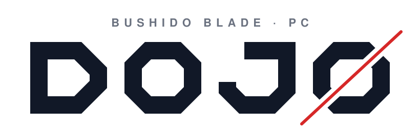

<p align="center">
  <picture>
    <source media="(prefers-color-scheme: dark)" srcset="docs/logo-dark.svg">
    
  </picture>
</p>

<p align="center">
  <b>Bushido Blade on PC.</b> A native Windows port of the 1997 PlayStation sword-fighting game.
</p>

<p align="center">
  <a href="https://github.com/tisquantum/dojo/releases/latest"></a>
  <a href="https://github.com/tisquantum/dojo/releases/latest"></a>
  <a href="https://discord.gg/gbU9rDZRh"></a>
  <a href="LICENSE"></a>
</p>

---

Dojo is built from the game's decompiled source, with things the console never had: real frame rates above the
game's 30 (60, 120, 144, 165 and beyond: the game's own logic runs more often, nothing is interpolated), any
aspect ratio from 4:3 to 32:9, and online play with rollback netcode: quick play, private matches and King of
the Hill. Questions, matches and bug reports: join the [Discord](https://discord.gg/gbU9rDZRh).

**No game data is included.** You play with your own copy of the game; the build and the game read it from your
disc image. Don't share builds of the game: `dojo.exe` contains the game's code.

## Playing

### What you need

- **Windows 10 or 11, 64-bit.**
- **A graphics card with Vulkan 1.3** (any recent NVIDIA, AMD or Intel driver). Without one, the game can use
  its software renderer (Settings → Renderer).
- **Your own disc image of Bushido Blade (USA)**, ripped as `.bin` + `.cue` (a raw 2352-byte-sector image;
  an `.iso` won't work). The file names don't matter. The launcher's **Verify disc** checks it against the
  known good copy (SHA-256 `c5cba1e3e8bc68f15e32492907ac37add7f8e8d3e10ddb36742a729ce1a970bf`).
Nothing else: the release carries every tool it builds with and the game's decompiled source. The game itself
is built on your PC from that source and your disc, because a finished game can't be shared.

### Playing with the launcher

1. Download `Dojo-<version>-windows.zip` from the [Releases](https://github.com/tisquantum/dojo/releases) page
   and unzip it anywhere (keep the whole folder together).
2. Open **`Dojo.exe`**. Windows SmartScreen may warn about an unsigned app: **More info → Run anyway**.
3. **Game** tab: under *Disc image*, choose your `.cue`, `.bin` or the folder holding them (**File...** or
   **Folder...**). Optionally press **Verify disc**.
4. **Settings** tab: pick your frame rate, aspect ratio, resolution, full screen and so on, and your name for
   online play. Everything saves as you change it.
5. Press **Play**. The first time it builds the game (a few minutes; the **Build** tab shows progress). After
   that, Play starts the game straight away.

If the game closes with an error, its last output appears in the **Build** tab, and **Open game log** opens
`dojo.log`. Your saves are in `saves/` and your settings in `build/dojo.ini`.

**Updates install themselves.** When the launcher opens it checks the latest release on GitHub; if there's a
newer version it downloads it (a few MB: the toolchain only comes along when it changed), checks its SHA-256,
and once the game is closed puts it in place and reopens. Your saves and settings stay. Play then rebuilds the
game from the new source. Untick *Keep Dojo up to date* on the Game tab to be asked instead (a banner with
**Update now**). Versions before 0.1.2 can't update themselves: download that one by hand, keeping `saves/` and
`build/dojo.ini`.

### Without the launcher

In the release folder (or a checkout with the toolchain, see below):

```
toolchain\cmakein\cmake -S . -B build -G Ninja -DCMAKE_BUILD_TYPE=Release ^
      -DDOJO_DECOMP_DIR=decomp -DDOJO_DISC=<your disc .bin>
toolchain\cmakein\cmake --build build
build\dojo.exe "<your disc .bin>"
```

The release's `decomp` folder is the `dojo` branch of
[tisquantum/bushido](https://github.com/tisquantum/bushido/tree/dojo) at the commit that version was made with
(in a checkout, the launcher downloads it). Started without a disc path, `dojo.exe`
looks for `game_files/Bushido Blade (USA).bin` in the folder it is started from or the two above it.

### Controls

The defaults (every button can be rebound in the launcher's **Controls** tab, or in the game: **F1**, Controls):

| PlayStation | Keyboard | Gamepad |
|---|---|---|
| D-pad | Arrow keys | D-pad (or the left stick, if switched on) |
| Triangle / Circle / Cross / Square | S / C / X / Z | Y / B / A / X |
| L1 / R1 | Q / E | Shoulder buttons |
| L2 / R2 | 1 / 3 | Triggers |
| Start / Select | Enter / Backspace | Start / Back |
| Options menu | F1 or Esc | Guide button |
| Go back, leave a queue or a match | Hold Backspace for 2 seconds | Hold Back for 2 seconds |
| Full screen | F11 | |

The Controls page picks each player's gamepad (auto takes the first free one; with several plugged in, choose
which), which player the keyboard and mouse belong to, the left stick as the d-pad and its dead zone, and
rumble. Each console button has two gamepad bindings and two keyboard-and-mouse ones (keys, mouse buttons,
gamepad buttons, triggers or stick directions): Enter or A on a cell waits for the button to bind (Esc
cancels, Delete clears), Delete or Y on a cell clears it, and Reset puts a row back. Rumble follows the game's
own DualShock pulse. A DualSense on a USB cable plays it on its haptic actuators instead (through the
controller's sound device, which Windows shows as "DualSense Wireless Controller"); over Bluetooth, or with
DualSense haptics off, it gets SDL's motor rumble.

The launcher's Controls tab has the same settings: click a cell, then press the key, mouse button or gamepad
button (right-click clears it); *Test rumble* shakes a player's gamepad. The launcher reads the gamepads itself,
through a 64-bit SDL3.dll packaged into Dojo.exe (`tools/make_release.py` puts it in
`dist/_pyinstaller/sdl64`, where a checkout's launcher looks too), so this works before the game is built. Once
it is, *Test rumble* runs `dojo.exe --test-rumble 1|2`, which rumbles the way the game does, a wired DualSense's
haptics included (`--pads` and `--capture-pad` are the game's other helpers).

### Settings

The launcher's Settings tab and the in-game options menu (**F1**) change the same file, `dojo.ini`, beside
`dojo.exe` (in `build/`). It can also be edited by hand:

| Key | Values | |
|---|---|---|
| `fps` | `0` (match the display) or 30 to 480 in steps of 30 | The game's rate. `30` is the original exactly. Online, both players run the higher of their two rates. |
| `aspect` | `auto`, `4:3`, `16:10`, `16:9`, `21:9`, `24:10`, `32:9` | Aspect ratio; `auto` matches the display. |
| `scale` | 1 to 8 | Resolution as a multiple of the console's 320x240 (Vulkan only). |
| `software` | 0 / 1 | 1: the software (CPU) renderer instead of Vulkan. |
| `fullscreen`, `vsync`, `show_fps` | 0 / 1 | Full screen, v-sync, frame counter. |
| `volume` | 0 to 100 | |
| `analog_stick` | 0 / 1 | The left stick works the d-pad. |
| `stick_deadzone` | 10 to 90 | How far, in percent, a stick goes before it counts as a direction. |
| `rumble` | 0 to 100 | Rumble strength; 0 is off. |
| `dualsense_haptics` | 0 / 1 | A wired DualSense rumbles with its haptic actuators. |
| `pad1`, `pad2` | `auto`, `none` or an SDL GUID | Each player's gamepad (`pad1_name`, `pad2_name`: its name). |
| `keyboard_player` | 1 / 2 | The player the keyboard and mouse belong to. |
| `bind_cross` ... `bind_right` | four hex numbers | Two gamepad, then two keyboard-and-mouse bindings (`src/input.h`); 0 is none. |
| `name` | letters, digits, `_`, `-` | Your name online. |
| `server` | `host:port` | The matchmaking server. The official one is `dojo-matchmaker.fly.dev:7777`. |
| `offline` | 0 / 1 | 1: never contact the server (direct matches still work). |
| `p2p_port` | UDP port, default 7778 | The port a direct match is hosted on. |
| `online_delay` | `-1` (auto) or 0 to 8 | Online input delay in fields (1/60 s). Auto measures the round trip while the match is set up and takes the least that leaves rollback a field or two to hide: 0 on a LAN, 1 at about 70 ms, 2 from 100 ms. Both players get the larger of their two choices. |
| `watch_hill` | 0 / 1 | Watch King of the Hill fights while waiting in line. |

Frame rate, resolution, full screen, v-sync, volume and the frame counter apply at once; aspect ratio and
renderer on the next start.

### Online

Press **F1** in the game and choose **Play online**:

- **Quick play**: matched with whoever else is looking.
- **Private match**: create a room and read its six-letter code to a friend, who joins with it. Or skip the
  server: **Host directly** (the host forwards UDP port 7778 on their router to play over the internet) and the
  friend uses **Join directly by address**.
- **King of the Hill**: the winner stays on and challengers wait in line, watching the current fight. Public,
  or private by code.

Matches use rollback netcode, and players with different refresh rates can play each other. The input delay
follows the connection (0 on a LAN), and the controllers are read before every tick of the simulation, so at
a high frame rate a press counts within a few milliseconds, online as well as off. Pausing is off in an
online fight. Memory cards are off during online matches; your own game is set aside and comes back after.

## For developers

Working from a checkout of this repository: `python tools/fetch_toolchain.py` downloads the toolchain into
`toolchain/` (llvm-mingw for 32-bit x86, CMake, Ninja, embeddable Python, SDL3, the Vulkan headers and glslang,
each checked by SHA-256), then `python launcher.pyw` works as the release's `Dojo.exe` does. Everyone builds
with the same tools and the build is reproducible (no timestamps or folder names in the program), so a given
version builds to the same bytes on every PC, which online play relies on. `python tools/make_release.py`
makes the release zip in `dist/` (it needs PyInstaller for `Dojo.exe`), plus `Dojo-<version>-update.zip` and
`dojo-update.json`: upload all three to the GitHub release tagged `v<version>`, or the launchers out there won't
see it (they read `releases/latest/download/dojo-update.json`). `DOJO_UPDATE_URL` points a launcher at another
manifest for testing; a checkout never replaces its own files. Releases build `Release`;
`RelWithDebInfo` adds a PDB for crash addresses and `tools/statediff.py`.

### State

The game boots and plays natively, with sound: the publisher's splash, the opening demo and its staff roll,
the title menu, character and weapon select, the Story prologue, VS bouts, and the movies (the opening in the
Movie Theater, the endings) with their sound. A Vulkan renderer draws at
any multiple of the console's resolution with sub-pixel geometry, in any aspect ratio. Combat runs natively at
the display's rate (60, 120, 144, 165 and up: the game's own logic, more often, not frames in between). Two
machines play online with rollback, at different refresh rates too.

### Options, online and testing in detail

Options: **F1** (or Esc, or a gamepad's guide button) opens the options menu over the game, which waits
while it is open (online it runs on). Frame rate, resolution, full screen, vsync, volume and a frame counter
apply at once; aspect ratio and renderer on the next start; online the frame rate is the match's. Settings are
kept in `dojo.ini` beside the executable. Environment variables set them for one session:
`DOJO_ASPECT` (`16:9`, the default; `21:9`, `4:3`, ...), `DOJO_SCALE` (resolution as a multiple of the
console's, default 4), `DOJO_RENDERER=software` (the 1x CPU renderer), `DOJO_FPS` (the simulation's
rate, rounded to a multiple of 30 up to 480; the default follows the display, `30` is the console's game
exactly).

Online: **Play online** in the menu (F1) offers quick play, private matches (one player creates a room and
reads its six-letter code to the other), and King of the Hill (the winner stays on, the others wait in line;
a hill can be public or private by code), through the matchmaking server in `port/server`. A private match
can also go player to player with no server: **Host directly** waits on UDP port 7778 (`p2p_port` in
`dojo.ini`; forward it on the router to play over the internet) and shows this PC's addresses, and **Join
directly by address** connects to one. The rest go through the server (its README says
how to run it on fly.io; `server = host:port` in `dojo.ini` points the game at it, `name = ...` sets the
name others see). Holding Back (Backspace or the gamepad's back button) for two seconds leaves a queue, goes
back a page, or leaves a match. While waiting for an opponent the offline game goes on; on a hill, those in line watch the fight being fought
(the players send its settled inputs through the server and each watcher runs the same fight from the same
start a second behind; the waiting page turns it off, holding Back stops it). Each match starts from
the VS character select, the same state on both machines (each makes it from power-on and they compare);
the offline game is put aside and comes back after. Direct play without the server: one machine runs with
`DOJO_NET=host:PORT`, the other with `DOJO_NET=join:ADDRESS:PORT` (UDP; the host's port must be
reachable). `DOJO_NET_DELAY` sets the input delay in fields (default 2; the two
take the larger). The window title shows the round trip, the rollbacks and any desync. Memory cards are off in
an online match. `DOJO_NET_LAG` (ms) and `DOJO_NET_LOSS` (percent) simulate a bad network.

Keyboard: arrows, Z square, X cross, C circle, S triangle, Q L1, E R1, 1 L2, 3 R2, Enter start, Backspace
select; F11 full screen (all rebindable in F1, Controls). Saves go to `saves/bu00`. `DOJO_MENU_KEYS`
("Down,Down,Return", SDL key names) presses keys in the menu `DOJO_MENU_AT` opens, for testing its pages.

For development: `port/check.sh` syntax-checks the game against the SDK headers; `port/undefined.sh`
builds and lists what the link still lacks. Scripted runs use environment variables: `DOJO_PRESS`
(`field:buttons,...`, `p2` for the second pad), `DOJO_SHOT_EVERY` (BMP screenshots), `DOJO_EXIT_FIELD`,
`DOJO_FAST` (no real-time pacing), `DOJO_ONLINE` (`quick`, `create`, `join:CODE`, `koth`,
`koth:CODE`: online play from a script), `DOJO_SERVER`, `DOJO_NO_DIRECT` (always relay), `DOJO_MENU_AT` (open the options menu at a field and save its
picture), `DOJO_APPLY_AT` (`field:scale=N,field:vsync=N,field:fps=N`, settings changed mid-run), `DOJO_HASH_EVERY` (log the simulation's hash), `DOJO_STATE_TEST=F,G`
(save at F, run to G, restore and run again, compare), `DOJO_DUMP_STATE=F` (the state, its regions on
stderr), `DOJO_DUMP_DESYNC` (netplay saves its state before a field the two machines disagree on, as
`desync_p<player>_<field>.bin`), `DOJO_PRESS_TICKS=seed` (the local controller changes from one tick's
sample to the next, for testing netplay's per-tick input), `DOJO_DUMP_SETTLED=field` and `DOJO_DUMP_WATCH=field`
(a player's settled state before that field, a spectator's; `all` for every checked field to 600), and
`DOJO_HIDDEN` (no window on the screen, the software renderer and the default settings, dojo.ini neither read
nor written: for tests run while someone uses the machine). Release builds write no PDB, so for
`tools/statediff.py` build RelWithDebInfo, or the names it gives come from an older build. `tools/statediff.py` compares two dumps variable by variable through the builds' PDBs (pointers by
what they name), so a build can be checked against an older one even when variables were added.
`-DDOJO_TRACE=ON` keeps a call stack of the game's functions for crash reports; crashes print addresses to
resolve with `llvm-symbolizer --obj=port/build/dojo.exe`.

## Design

**The game stays C, and stays the decompilation.** The 98 units of `src/` compile as they are, but for three
places that depend on where the console's linker put things (each under `#ifdef TARGET_PC`, so the matching
build is untouched): the model arena's buffers kept end to end (`model_arena.c`), a table the select screen's
host figure writes a third row of (`fighter_pose.c`), and a fade drawn before any has started
(`screen_fade.c`); a null collider the select screen writes through (`fighter_cloth.c`); and the frame-rate
changes below.

**32 bits, with the console's memory where the console has it.** The game is 32-bit to the bone: disc files
hold absolute pointers for their load addresses, and ordering-table links hold 24-bit addresses. The port is
an x86 executable linked at 0x400000, so the image (globals, the 1 MB VRAM, the game's stack) lies below
16 MB, and it maps the console's 2 MB of RAM at 0x80000000 (`src/memory.c`), the address the console's code
and data use. A link below 0x200000 is in that RAM; any other is in the image.

**The hand-written assembly is translated, not rewritten.** `tools/mips2c.py` turns the renderer
(`src/render.s` and three small units) and LIBGTE, which the decompilation holds as assembly, into C at build
time. Every instruction keeps a code address, so the assembly's own tricks (state in registers across
calls, drawers returning into the middle of other routines, a jump into an unrolled copy) work as written;
delay slots, the stack arguments of the MIPS ABI and GTE instructions are handled exactly.

**The libraries the game calls are the port's, or the decompilation's own.**

| Library | In the port |
| --- | --- |
| LIBGTE | translated from the decompiled assembly, over a register-accurate software GTE (`src/gte.c`) |
| LIBGPU | the decompiled `prim.c` and `ext.c`; the system layer (`src/libgpu.c`) over a software rasterizer of the GPU's commands into 1 MB of VRAM (`src/gpu.c`) |
| LIBCD | a virtual drive over the disc image at command level, with LIBCD's streaming ring for the movies (`src/libcd.c`) |
| Kernel, LIBETC, pads | `src/kernel.c`: events, root counters, vertical blank, the pad buffers |
| Memory card | `src/memcard.c`: a formatted card per slot, a folder of files |
| LIBSND, LIBSPU | the decompiled libraries whole, over an emulated SPU (`src/spu.c`) behind its registers (`src/mmio.c`); XA decoded from the drive (`src/xa.c`) |
| LIBPRESS | the decompiled library (its VLC decoder translated from assembly) over an emulated MDEC (`src/mdec.c`) |
| LIBCOMB | a stand-in (`src/interim.c`): the link cable is absent |

**Hardware registers.** LIBSPU and LIBSND drive the sound processor through its registers, as they do on the
console. The I/O page is mapped read-only at 0x1F801000, kept current by the emulated devices; every write
faults, and the handler decodes the store and hands it to the device (`src/mmio.c`).

**Movies.** The player (`src/movie.c`) streams each STR file with `CdRead2` and LIBCD's ring, decodes a frame's
bitstream with LIBPRESS's `DecDCTvlc` and has the MDEC turn it into pixels. The drive reads at the console's
double speed, putting each video sector's header and data where LIBCD's interrupt handler would and handing the
interleaved XA sectors to the audio decoder, so picture and sound keep the console's timing. The MDEC sits
behind its registers and DMA channels 0 and 1 (`src/mdec.c`): run-length blocks, zigzag dequantisation, the 8x8
inverse DCT by the table LIBPRESS loads, YUV to RGB, in integers. A movie is simulation like the rest: a save
state taken mid-movie runs on identically.

**Rendering.** `src/vk_renderer.c` (Vulkan 1.3) draws the GPU's primitives at a multiple of the console's
resolution into surfaces of its own; its shaders read textures and colour tables from a copy of video memory
as the console's GPU does. Rendered pixels go back to video memory only when the game reads them. Each
projection's exact position is kept (`GtePreciseLookup`, `src/gte.c`), so geometry is placed to the sub-pixel
rather than the console's whole pixels. Widescreen widens the display buffers; the drawers' and the stage
cull's edge tests are widened to match (`tools/mips2c.py`, `src/stage_cull.c`).

**Time is emulated, so the game is deterministic.** The game runs in a context of its own (`src/context.c`)
and switches to the host at each vertical blank. Its clock advances when it reads the hblank counter or
waits for a blank, never with wall time, so the main loop's `rand()` spin runs the same number of times every
frame and a bout is a function of the pads alone: two runs with the same input are identical frame for frame.

**Save states and determinism.** Everything the simulation touches (the game, the decompiled libraries, the
translated assembly and the port's emulated hardware) is compiled into its own sections (`src/sim_sections.h`);
a save state is those, main RAM, the I/O registers and the used part of the game's stack with its saved
stack pointer, so it can be taken at any vertical blank, mid-load included (`src/savestate.c`, about 5 MB).
Host work (input, audio output) runs on the host's stack, never the game's. The simulation is a function of
the two controllers alone: its hash is the same field for field with the software renderer at 1x and Vulkan at
2x or 4x. The widescreen setting does change what the game writes (the drawers fill packets for faces in the
margin), so it is a setting of the simulation, agreed in an online match like the input delay.

**Rollback** (`src/netplay.c`). Each field each machine saves the state, runs both players (the other's input
predicted as its last), and when the real input arrives and differs, loads the state before that field and
runs forward again with drawing and sound left out. Inputs go over UDP with everything unacknowledged
repeated, so loss costs nothing; the machine that runs ahead waits a field now and then; every 30 fields both
compare the hash of a field they have both settled. Tested on one machine with 80 ms of added lag and 10%
loss each way, one side 16:9 and the other 4:3: boot to a VS bout, about 200 fields rolled back on each side,
every one of 89 settled hashes equal.

**Frame rates above 30, by the game's own code** (`include/substep.h`, `port/sdk/include/pc_substep.h`). A
console frame of combat is run as N ticks (N = rate / 30, 1 to 16); each tick runs the whole combat state and
draws a picture. Continuous motion advances by the tick's share of the frame: the animation clock (poses and
root motion already interpolate within a frame), velocities and gravity, turning, the camera's smoothing, the
look angles, particles, waves (`PC_SHARE`; a per-frame damping or approach becomes its N-th root,
`PC_DECAY_EX`, `PC_APPROACH_EX`). What happens once a frame stays once a frame, on its last tick, which is the
console's frame: pad edges, the CPU's decisions, hits and clashes, timers and lifetimes, spawns, sounds, the
cloth solve (drawn carried with the body between solves), every `rand()`. Every macro is the original code with
one tick a frame and on the console (`include/substep.h` keeps the matching build), and frames of any state that
doesn't substep (menus, loading) run as one tick at any rate, so `DOJO_FPS=30` is the console's game:
a 6000-field run with three bouts compares equal to the build before these changes in every variable and all of
main RAM (`tools/statediff.py`). At 60, 120, 144 and 480 runs are deterministic and pass the save-state round
trip; online, a 60 Hz and a 120 Hz machine agree on 4 ticks and settled 149 of 149 hashes equal through rollbacks
under 80 ms lag and 10% loss. Online the rate is agreed like the input delay (the faster).

The scenes the fighters play in substep the same way (`PcStateSubsteps`): the attract mode's bout, the replay,
the victory and continue screens, and the Slash-clear and castle-approach cutscenes, whose camera sweeps count
in ticks (`PC_TICKS`) and whose scripted buttons are held through a frame's ticks as a pad's are. The replay
shows the bout as it was played: the console's ring records a frame's last tick, and the port's
(`sPcReplayTicks` in `src/replay.c`) the ticks before it, which playback shows on the same ticks of each frame
(a bout played at another rate shows the recorded ticks nearest its own). Thrown and kicked sub-weapons fly by ticks
too, their hits still tested once a frame along the whole frame's path. The story's dialogue cutscenes and the
title's flyover play camera and pose tracks baked at 30 frames a second, so they still show each frame for a
whole frame's ticks. At 30 a run through three replays, victory and continue screens and an attract-mode bout
compares equal to the build before in all of main RAM and every variable (bar the known uninitialised-stack
noise); at 120 runs are deterministic and pass the save-state round trip in each of those states.

## Order of work

Rumble is done (`src/input.c`); nothing else is queued.

## Credits

Dojo stands on [virtualonno/bushido](https://github.com/virtualonno/bushido), the matching decompilation of
Bushido Blade by virtualonno: the game's code, rebuilt as C source that compiles back to the original
executable byte for byte. Without that work there would be no port. Dojo's changes to it live on the `dojo`
branch of [tisquantum/bushido](https://github.com/tisquantum/bushido/tree/dojo), a fork of their repository.

## License

Dojo's own code is released under the [MIT License](LICENSE). It covers this repository only: not the game,
which you need your own copy of, nor the decompilation it is built from. The tools bundled in the release keep
their own licences (`THIRD_PARTY.md` in the release).
